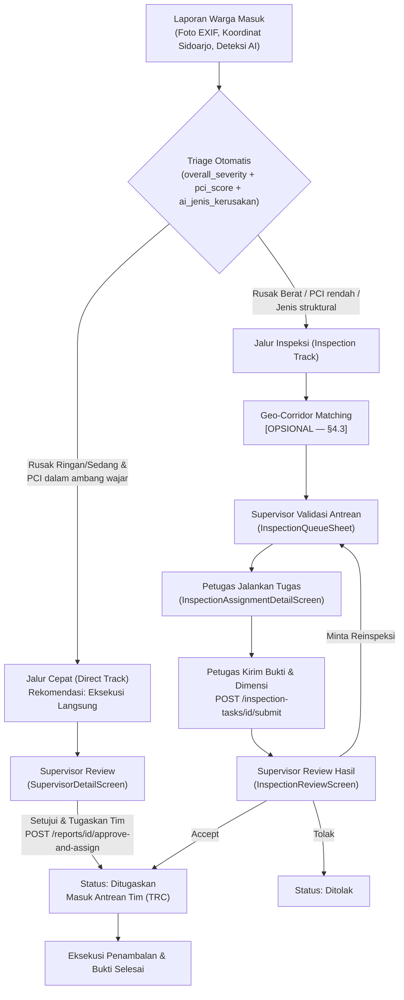
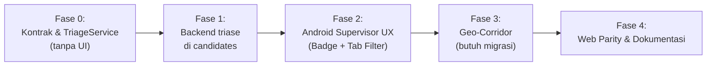

# REVISI — Rencana Alur Kerja Laporan Warga (Dual-Track Triage)

**Status:** Revisi atas `docs/plan-alur-kerja-laporan-warga-dual-track.md`
**Tanggal revisi:** 2026-11-15
**Sifat:** Dokumen perencanaan. **Belum ada kode yang diubah.**
**Metode:** Crosscheck langsung ke kode `backend_POSTGRESQL/`, `android-native/`, `Frontend-stable/`, dan respons API produksi.

> **Cara membaca:** setiap perubahan diberi tanda
> 🔴 **BLOKIR** = plan lama akan gagal bila diikuti harfiah ·
> 🟠 **KOREKSI** = salah fakta/nama/domain ·
> 🟢 **TAMBAHAN** = prasyarat yang belum tercantum ·
> ✅ **DIPERTAHANKAN** = sudah benar, jangan diubah.

---

## 0. Ringkasan Eksekutif Revisi

Rancangan Dual-Track **layak dibangun**, tetapi versi lama tidak dapat dieksekusi apa adanya. Tiga masalah bersifat memblokir:

1. **Jalur Cepat tidak akan pernah aktif.** Syarat triase memakai `ai_confidence` dan `damage_type` yang tidak tersedia pada data produksi. Hasilnya 100% laporan masuk Jalur Inspeksi — persis masalah yang ingin dipecahkan.
2. **Geo-Corridor Matching mustahil dijalankan** karena `inspection_sessions` tidak menyimpan koordinat. Tidak ada "titik awal patroli" untuk dihitung.
3. **Nama field body API salah**, sehingga pilihan tim dari supervisor hilang diam-diam tanpa pesan error.

Revisi ini mengganti basis triase ke **severity + PCI** (data yang benar-benar ada), memindahkan Geo-Corridor ke fase yang bergantung pada migrasi, dan mengoreksi seluruh nama field/path/test.

### Matriks keputusan

| Area | Plan lama | Revisi | Alasan |
|---|---|---|---|
| Basis triase | `ai_confidence ≥ 0.70` + `damage_type == 'pothole'` | `overall_severity` + `pci_score` + `ai_jenis_kerusakan` | `ai_confidence` kosong di root payload; `damage_type` tidak ada |
| Domain severity | `'low'`, `'medium'` | `'Rusak Ringan'`, `'Rusak Sedang'` | Domain nyata di DB & `PciService` |
| Nama field tim | `team_id` | `assigned_team_id` | Yang dibaca `ReportController.php:2477` |
| Nilai prioritas | `"high"` | `"Tinggi"` / `"Sedang"` / `"Rendah"` | `Report::PRIORITY_VALUES` |
| Geo-Corridor | Fase 1 | **Fase 3** (butuh migrasi) | `inspection_sessions` tanpa koordinat |
| Satuan jarak | campur `distance_meters` & `distance_km` | `distance_meters` (integer) | Satu satuan, konsisten |
| Test | `NativeInspectionTest`, `ReportApprovalTest` | `NativeInspectionWorkflowTest` | Nama test lama tidak ada (0 test = "lulus" palsu) |

---

## 1. Prinsip Desain (✅ DIPERTAHANKAN, dengan penajaman)

Seluruh §1.1 (latar belakang bottleneck vs ghost task) dan §1.2 (Dual-Track + human-in-the-loop + transparansi status) **tetap dipertahankan apa adanya**. Diagnosis masalahnya benar dan tetap relevan.

Penajaman yang ditambahkan:

- **🟢 Triase harus berbasis data yang terbukti ada.** Rekomendasi jalur hanya boleh memakai kolom yang benar-benar terisi. Rujuk §4 revisi.
- **🟢 "Geo-clustering" adalah fitur opsional, bukan fondasi.** Bila posisi tim tidak diketahui, sistem tetap harus bisa merekomendasikan jalur. Jangan menjadikan jarak sebagai syarat mutlak.

---

## 2. Blueprint Alur (✅ DIPERTAHANKAN, 2 penyesuaian)

Struktur `mermaid` pada §2 lama dipertahankan. Dua penyesuaian:

1. 🟠 Node `B` (Triage) diberi keterangan input yang benar: **`overall_severity`, `pci_score`, `ai_jenis_kerusakan`** — bukan `Confidence Score`.
2. 🟠 Node `H` (Geo-Corridor ≤2 km) ditandai **[OPSIONAL — lihat §4.3]**. Bila posisi tim tidak tersedia, alur melompat langsung `H → I` dengan pengurutan berdasarkan severity/PCI.



---

## 3. Spesifikasi Dua Jalur

### 3.1 Track 1 — Direct Track

| Parameter | Spesifikasi lama | **Revisi** |
|---|---|---|
| Kriteria pemicu | `pothole`, severity low/medium, `ai_confidence ≥ 0.70` | 🔴 **Diganti** — lihat tabel di bawah |
| Aksi supervisor | Buka detail → pilih tim → "Setujui & Tugaskan Tim" | ✅ **Dipertahankan** (tombol sudah ada di `SupervisorDetailScreen.kt:668`) |
| Endpoint | `POST /api/reports/{id}/approve-and-assign` | ✅ Benar |
| Body | `{"team_id":12,"priority":"high","notes":"..."}` | 🔴 **Diganti** — lihat §3.1.2 |
| Dampak | Status → `Disetujui`, notifikasi ke TRC | 🟠 **Koreksi status** — lihat §3.1.3 |

#### 3.1.1 🟢 Kriteria pemicu baru (berbasis data yang terbukti ada)

```text
DAMAGE_TYPE := ai_jenis_kerusakan   -- kolom nyata; 'damage_type' tidak ada.

IF  overall_severity IN ('Rusak Ringan', 'Rusak Sedang')
    AND (pci_score IS NULL OR pci_score >= 56)      -- >= ambang "Rusak Sedang" PciService
    AND COALESCE(ai_jenis_kerusakan, '') NOT IN ('Amblas', 'Retak Buaya', 'Patahan Slab')
THEN
    suggested_track = 'direct'
    reason = 'Kerusakan rutin; severity dan PCI berada pada ambang eksekusi langsung'
ELSE IF overall_severity = 'Rusak Berat' OR pci_score < 56
THEN
    suggested_track = 'inspection'
    reason = 'Kerusakan berat/struktural; perlu verifikasi volume dan kondisi lapangan'
ELSE
    suggested_track = 'inspection'
    reason = 'Data severity/PCI belum lengkap; verifikasi lapangan dianjurkan'
END IF
```

**Mengapa bukan `ai_confidence`.** Terverifikasi pada respons `GET /reports` produksi (40+ field) bahwa `ai_confidence` **tidak dikirim di root**. Kolom ini hanya muncul di sub-objek `photos[]` pada endpoint detail, melalui `Report::ensurePrimaryPhotoInPhotos()`. Selain itu `ai_confidence` untuk data lama diisi acak oleh `BackfillPhotoData.php:61` (`0.65 + mt_rand()/mt_getrandmax()*0.34`) — **tidak layak dijadikan dasar keputusan operasional**.

**Mengapa PCI layak.** `pci_score` sudah dihitung otomatis saat approval (`PciService::calculateFromReport`), tersedia di payload, dan ambangnya terdefinisi jelas di `PciService.php:20-23`:

| Kategori | Rentang PCI |
|---|---|
| Baik | 86–100 |
| Rusak Ringan | 71–85 |
| Rusak Sedang | 56–70 |
| Rusak Berat | 41–55 |

#### 3.1.2 🔴 Body request yang benar

```json
{
  "assigned_team_id": 12,
  "priority": "Tinggi"
}
```

- `team_id` **tidak dibaca** oleh backend. Sumber: `ReportController.php:2477` → `$request->input('assigned_team_id')`.
- Prioritas harus salah satu dari `Report::PRIORITY_VALUES` = `['Rendah', 'Sedang', 'Tinggi']` (`Report.php:228-231`). Nilai `"high"` akan dibuang menjadi `null` (`ReportController.php:2460-2464`) lalu jatuh ke prioritas lama.
- `notes` **tidak diproses** oleh `approveAndAssign()`; yang dicatat adalah `system_notes` otomatis `[APPROVED] Disetujui oleh {nama}`. Hapus dari kontrak atau pindahkan ke endpoint terpisah.
- ⚠️ **`approveAndAssign()` tidak memiliki `validate()`.** Kesalahan nama field tidak menghasilkan error — hanya perilaku senyap. Revisi menambahkan butir penguatan di §5.1.1.

#### 3.1.3 🟠 Status akhir bukan `Disetujui`

`approveAndAssign()` menulis `status = 'Ditugaskan'` (`ReportController.php:2500`), bukan `'Disetujui'`. Nilai sah menurut `Report::STATUS_VALUES` (`Report.php:249`) mencakup keduanya, sehingga dokumen harus konsisten memakai **`Ditugaskan`** untuk jalur ini.

### 3.2 Track 2 — Inspection Track

✅ Endpoint pada §3.2 lama **sudah terverifikasi benar seluruhnya** (`routes/api.php:367-376`). Dipertahankan.

Koreksi:

- 🟠 Langkah 1 lama: *"menandai rekomendasi `inspection_required`"* — **kolom ini tidak ada**. `suggested_track` juga tidak disimpan. Keduanya **dihitung on-the-fly** saat response dibentuk. Dokumentasi harus menyebut ini eksplisit agar tidak ada yang mencari kolom DB.
- 🟢 Langkah 2 (mask ke antrean) tidak memerlukan perubahan — `InspectionQueueSheet.kt` sudah ada. Yang kurang hanya tab filter (§5.2.2).

---

## 4. Mekanisme Otomatisasi

### 4.1 🟠 Kalkulasi `suggested_track`

Lihat §3.1.1. Perubahan kunci: input bukan `ai_confidence`.

### 4.2 🟠 Kontrak response `GET /api/inspection-queues/candidates`

Plan lama memakai `distance_km` di JSON tetapi `distance_meters` di narasi. **Revisi menetapkan satu satuan: `distance_meters` (integer).**

```json
{
  "success": true,
  "data": [
    {
      "id": "01a1dea1-c0ba-710b-a34a-ea312becd286",
      "report_code": "LP-2026-00001",
      "reporter_name": "bangkit",
      "road_name": "Sidoklumpuk",
      "district": "Sidoarjo",
      "latitude": -7.4445851,
      "longitude": 112.7270596,
      "status": "Menunggu Review",
      "source": "warga",
      "created_at": "2026-11-15T16:55:05+07:00",
      "triage": {
        "suggested_track": "inspection",
        "recommendation_label": "Disarankan Inspeksi Lapangan",
        "basis": {
          "overall_severity": "Rusak Berat",
          "pci_score": 20.75,
          "ai_jenis_kerusakan": null
        },
        "is_corridor_match": null,
        "distance_meters": null
      }
    }
  ],
  "total": 1,
  "page": 1,
  "last_page": 1
}
```

🟢 **Catatan kompatibilitas:** field yang sudah ada (`id`, `report_code`, `reporter_name`, `road_name`, `district`, `status`, `source`, `created_at`) **wajib dipertahankan** karena sudah dibaca `InspectionQueueSheet` versi sekarang. Objek `triage` adalah **tambahan aditif** di dalam `data[]` — bukan mengganti struktur. Klien lama tidak boleh rusak.

`is_corridor_match` dan `distance_meters` bernilai `null` bila posisi tim tidak diketahui — bukan `0`, agar UI bisa membedakan "dekat" dari "tidak diketahui".

### 4.3 🔴 Geo-Corridor Matching — TIDAK DAPAT DIMULAI TANPA MIGRASI

**Temuan blokir.** Plan lama mengasumsikan backend dapat membaca *"lokasi terakhir tim patroli (koordinat tugas terakhir atau titik awal patroli hari ini)"*. Verifikasi skema `2026_11_09_000001_add_native_inspection_schema.php:23-38`:

```
inspection_sessions: id, survey_task_id, patrol_schedule_id, team_id,
                     started_by, schedule_type, status, started_at,
                     submitted_at, timestamps
```

**Tidak ada `latitude`/`longitude`.** Tidak ada migrasi lanjutan (dicek: tidak ada file lain menyentuh `inspection_sessions`).

Koordinat hanya tersedia di `inspection_results` dan `inspection_photos` — itu **hasil** inspeksi, bukan posisi tim saat ini.

#### Opsi posisi tim (pilih satu sebelum Fase 3)

| Opsi | Pro | Kontra |
|---|---|---|
| **A. Migrasi `inspection_sessions.start_latitude/start_longitude`** *(rekomendasi)* | Sederhana, 1 titik per sesi, cukup untuk kebutuhan | Hanya posisi awal; tidak mengikuti gerak tim |
| B. Manfaatkan `worker_locations` | Tabel + endpoint sudah ada (`WorkerLocationController`) | Diisi manual, tidak otomatis oleh alur patroli; bisa kosong |
| C. Koordinat foto hasil terakhir | Tanpa migrasi | Belum ada saat kandidat dibutuhkan (sesi baru mulai) |

**Keputusan revisi:** Geo-Corridor dipindahkan dari **Fase 1 → Fase 3**, dan Fase 3 diawali dengan migrasi opsi A. Sampai itu selesai, `triage.distance_meters` selalu `null` dan pengurutan memakai severity/PCI. Ini menjaga agar fitur inti (Dual-Track) tidak tertahan oleh fitur opsional (kedekatan).

Perhitungan jarak memakai `GeographicService::haversineDistance()` yang **sudah tersedia** (`GeographicService.php:55`) — jangan menulis ulang.

---

## 5. Rencana Perubahan Modul

### 5.1 Backend Laravel

#### 5.1.1 `NativeInspectionController::candidates()` — 🟠 diperluas, bukan diganti

Tambahan pada method yang ada (baris 88–137):
1. Parameter opsional `?session_id=<uuid>`.
2. Bila `session_id` valid & sesi `active` & punya koordinat → hitung `distance_meters` via `GeographicService::haversineDistance()`, tetapkan `is_corridor_match = distance_meters <= 2000`.
3. Bentuk objek `triage` per §4.2. Logika triase ditaruh di service (§5.1.3), **bukan** di controller.
4. Filter opsional `?track=direct|inspection` **diterapkan di PHP setelah mapping**, bukan di SQL — karena `suggested_track` adalah hasil hitungan, bukan kolom. (Menegaskan koreksi atas §5.1.1 plan lama yang menyiratkan filter SQL.)

#### 5.1.2 `ReportController::approveAndAssign()` — 🟢 penguatan (bukan fitur baru)

Fungsi sudah bekerja. Dua penambahan defensif:
1. Tambahkan `$request->validate(['assigned_team_id' => 'nullable|exists:teams,id', 'priority' => 'nullable|in:'.implode(',', Report::PRIORITY_VALUES)])`.
2. Tolak `team_id` (snake lama) dengan pesan jelas bila terkirim tanpa `assigned_team_id`, agar kesalahan integrasi tidak senyap.

#### 5.1.3 🔴 `TriageService.php` — TIDAK ADA, harus dibuat dari nol

Plan lama menyebutnya sebagai *"Baru/Penyempurnaan"* seolah mungkin sudah ada. Verifikasi `app/Services/`: **tidak ada**. Isi yang benar:

```php
// app/Services/TriageService.php  (BARU)
class TriageService
{
    public const DIRECT_SEVERITIES = ['Rusak Ringan', 'Rusak Sedang'];
    public const STRUCTURAL_TYPES  = ['Amblas', 'Retak Buaya', 'Patahan Slab'];
    public const PCI_DIRECT_MIN    = 56;  // batas bawah "Rusak Sedang" (PciService)

    /**
     * Baca kolom MODEL langsung, bukan payload HTTP.
     * `ai_confidence` sengaja TIDAK dipakai — kosong di root payload dan
     * sebagian diisi acak oleh BackfillPhotoData.
     */
    public function suggest(Report $report): array { /* §3.1.1 */ }
}
```

Input dibaca dari model `Report`: `overall_severity`, `pci_score`, `ai_jenis_kerusakan`.

### 5.2 Android Native

#### 5.2.1 🟠 `SupervisorDetailScreen.kt` — tambahan kecil

Tombol **"Setujui & Tugaskan Tim"** ✅ **sudah ada** (`:668`), termasuk dialog prioritas (`:718`, `:740`). Jangan dibuat ulang.

Yang benar-benar perlu ditambah:
1. **Badge triase** dari `triage.suggested_track`:
   - `direct` → hijau, "⚡ Siap Eksekusi Langsung"
   - `inspection` → kuning, "🔍 Disarankan Inspeksi Lapangan"
2. Tombol sekunder **"Jadwalkan Inspeksi Patroli"** → buka `InspectionQueueSheet`, **hanya tampil bila `suggested_track == 'inspection'`**.

🟠 **Koreksi path:** `SupervisorReportCard.kt` **tidak ada**. Bila badge perlu tampil di daftar, tempatnya adalah komponen kartu yang sudah dipakai — cek `ui/components/report/ReportCardParts.kt` dan `feature/supervisor/` sebelum membuat file baru.

🟢 **Konsistensi:** gunakan ulang `BadgeRow` dan `LokasiCard` di `ui/components/` (sudah ada, dipakai bersama supervisor/petugas). Jangan menulis ulang pill/badge lokal.

#### 5.2.2 `InspectionQueueSheet.kt` — 🟠 tambah tab filter

File ✅ ada (`feature/supervisor/InspectionQueueSheet.kt`), tetapi **tidak punya tab filter maupun pengurutan jarak** (verifikasi: tidak ada `Tab`/`distance`/`sortBy`).

Tambahan: tab `Semua Kandidat` dan `Rekomendasi Terdekat`. **Tab kedua harus menyembunyikan diri** (atau menampilkan state kosong yang jelas) bila `distance_meters` semuanya `null` — yaitu sampai Fase 3 selesai.

#### 5.2.3 `InspectionScreens.kt` & `InspectionResultScreen.kt` — ✅ dipertahankan

✅ Keduanya ada. Layar detail tugas inspeksi **baru saja diperkaya** (badge + `LokasiCard` ber-peta mini + tombol buka peta). Tidak perlu perubahan tambahan untuk plan ini.

#### 5.2.4 `InspectionReviewScreen.kt` — ✅ ada, 🟠 verifikasi komparasi foto

✅ File ada. Plan lama meminta *"visualisasi komparasi foto awal warga vs foto verifikasi petugas"*. Sebelum dijadwalkan sebagai pekerjaan, **verifikasi dulu** apakah `BeforeAfterSlider` (sudah ada di `ui/components/`) sudah dipakai di layar ini. Bila sudah, item ini selesai dan harus dicoret dari rencana.

### 5.3 Frontend Web

🟠 **Koreksi path.** Plan lama: `src/routes/supervisor/reports/index.tsx` — **tidak ada**. Struktur nyata (`Frontend-stable/src/routes/`):

```
supervisor.tsx
supervisor/index.tsx
supervisor/review.tsx
supervisor/patrol-schedule.tsx
supervisor/patrol-schedule/index.tsx
supervisor/patrol-schedule.detail.tsx
```

Rencana web harus menunjuk `supervisor/index.tsx` (daftar) dan **memastikan lebih dulu** file detail yang sebenarnya dipakai, sebelum menulis instruksi.

---

## 6. Strategi Pengujian

### 6.1 🟠 Nama test yang dirujuk plan lama TIDAK ADA

| Plan lama | Kenyataan |
|---|---|
| `--filter=NativeInspectionTest` | **Tidak ada** → 0 test dijalankan |
| `--filter=ReportApprovalTest` | **Tidak ada** → 0 test dijalankan |

Yang ada: **`tests/Feature/NativeInspectionWorkflowTest.php`** (18 test). Perintah yang benar:

```bash
cd backend_POSTGRESQL
composer run test -- --filter=NativeInspectionWorkflowTest
```

⚠️ Filter yang tidak cocok **tetap exit 0 dengan 0 test**. Selalu pastikan jumlah test yang berjalan > 0; jangan percaya "lulus" tanpa hitungan.

### 6.2 Pemetaan uji kasus

| # | Uji kasus plan lama | Status nyata | Tindakan revisi |
|---|---|---|---|
| 1 | `approveAndAssign` → `Disetujui` + `assigned_team_id` | 🟠 Status sebenarnya **`Ditugaskan`** | Test baru di `ReportApprovalTest.php` (**dibuat**) dengan ekspektasi `Ditugaskan` |
| 2 | `candidates` mengembalikan `suggested_track` akurat | ❌ Belum ada | Test baru berbasis `overall_severity`/`pci_score` |
| 3 | Laporan blocking tidak muncul lagi | ✅ **Sudah ada** — `test_queue_candidates_exclude_reports_with_blocking_assignment` | Tidak perlu dibuat |

🟢 Test tambahan yang direkomendasikan untuk `TriageService` (unit, SQLite cukup):
- `Rusak Ringan` + PCI 75 → `direct`
- `Rusak Berat` + PCI 45 → `inspection`
- `Rusak Sedang` + `ai_jenis_kerusakan = 'Amblas'` → `inspection` (jenis struktural menang atas severity)
- `overall_severity = null` → `inspection` (fallback aman, bukan `direct`)

### 6.3 🟢 Pengujian Android

```bash
cd android-native
./gradlew testDebugUnitTest lintDebug assembleDebug
```

Baseline saat ini: **9 unit test lulus, 118 warning lint, 0 error**. Revisi menetapkan baseline ini sebagai pembanding — penambahan tidak boleh menaikkan jumlah warning.

---

## 7. Roadmap Bertahap (🟠 direstrukturisasi)



| Fase | Isi | Prasyarat | Dapat dikirim sendiri? |
|---|---|---|---|
| **0** | `TriageService` + unit test + kontrak `triage` disepakati | — | ✅ ya |
| **1** | Perluasan `candidates()` (tanpa jarak) | Fase 0 | ✅ ya |
| **2** | Badge triase + tombol kontekstual + tab filter di Android | Fase 1 | ✅ ya |
| **3** | **Migrasi** `inspection_sessions` koordinat → Geo-Corridor | Fase 2 + persetujuan migrasi | ✅ ya |
| **4** | Web parity + dokumentasi pengguna | Fase 2 | ✅ ya |

🟢 **Perubahan penting dari plan lama:** Fase 3 sekarang **eksplisit bergantung pada migrasi** yang belum ada. Plan lama menempatkan Geo-Corridor di Fase 1 seolah backend hanya perlu "menghitung", padahal tidak ada data untuk dihitung.

🟢 Setiap fase harus bisa dirilis sendiri. Bila Fase 3 dibatalkan, Fase 0–2 tetap memberi nilai penuh (Dual-Track berfungsi, hanya tanpa pengurutan jarak).

---

## 8. Risiko yang Harus Diterima

| Risiko | Dampak | Mitigasi |
|---|---|---|
| 🔴 `ai_jenis_kerusakan` sering `null` di produksi | Deteksi tipe struktural tidak lengkap → lebih banyak laporan masuk `inspection` | Fallback ke `inspection` (aman); jangan memaksa `direct` bila data kosong |
| 🟠 `BackfillPhotoData` mengisi `ai_confidence` acak | Bila nanti dipakai, keputusan menjadi tidak dapat dipercaya | Revisi **melarang** pemakaian `ai_confidence` untuk triase |
| 🟠 `approveAndAssign` tanpa `validate()` | Kesalahan integrasi senyap | Tambahkan validasi (§5.1.2) |
| 🟠 Domain severity berbahasa Indonesia | Regex/syarat bergaya Inggris gagal senyap | Semua perbandingan memakai konstanta, bukan literal tersebar |
| 🟠 Migrasi menyentuh tabel inspeksi produksi | Risiko pada alur yang sedang berjalan | Hanya **tambah kolom nullable**; tidak mengubah kolom lama (sesuai aturan `AGENTS.md`) |

---

## 9. Daftar Koreksi Ringkas (untuk pelaksana)

1. `team_id` → **`assigned_team_id`**
2. `priority: "high"` → **`"Tinggi"`** (atau `Rendah`/`Sedang`)
3. Hapus `notes` dari body `approve-and-assign` (diabaikan backend)
4. Status akhir Direct Track: **`Ditugaskan`**, bukan `Disetujui`
5. Basis triase → **`overall_severity` + `pci_score` + `ai_jenis_kerusakan`**
6. `damage_type` → **`ai_jenis_kerusakan`**
7. Severity `'low'/'medium'` → **`'Rusak Ringan'/'Rusak Sedang'/'Rusak Berat'`**
8. Satuan jarak → **`distance_meters`** saja
9. Test → **`NativeInspectionWorkflowTest`**; `ReportApprovalTest` harus dibuat
10. Path web → `supervisor/index.tsx` (+ verifikasi detail)
11. Hapus `SupervisorReportCard.kt` dari rencana (tidak ada)
12. Geo-Corridor → **Fase 3 + migrasi**; jangan di Fase 1
13. `TriageService.php` → **benar-benar baru**, baca model langsung
14. Verifikasi `BeforeAfterSlider` di `InspectionReviewScreen` sebelum dijadwalkan

---

## 10. Yang Tidak Berubah dari Plan Asli

Agar tidak ada kesalahpahaman saat membaca berdampingan:

- ✅ Diagnosis masalah (§1.1) dan seluruh prinsip arsitektur (§1.2)
- ✅ Kelima endpoint inspeksi (§3.2) — semuanya ada dan benar
- ✅ `GeographicService::haversineDistance()` sebagai alat hitung jarak
- ✅ Gagasan badge triase dan tab filter
- ✅ Urutan besar roadmap: backend → Android → verifikasi → web
- ✅ Standar acuan (Manual Pemeliharaan Rutin, SP4N-LAPOR!, FixMyStreet/JAKI)
