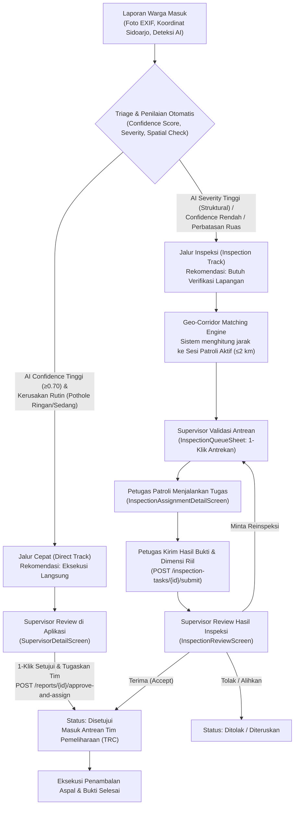
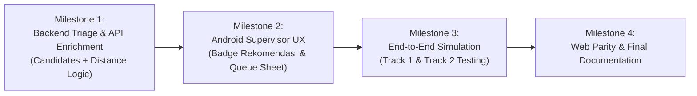

# Rencana Arsitektur & Alur Kerja Laporan Warga (Dual-Track Triage & Semi-Automated Inspection)

**Dokumen Perencanaan Resmi — DeltaJalan (JalanKita)**  
**Target Komponen:** Backend Laravel (`backend_POSTGRESQL/`), Android Native (`android-native/`), Frontend Web (`Frontend-stable/`)  
**Dasar Standar:** Manual Pemeliharaan Rutin Jalan Bina Marga (No. 001/M/BM/2011), Standar Pelayanan Pengaduan SP4N-LAPOR!, dan Civic Tech Workflow (FixMyStreet / JAKI).

---

## 1. Eksekutif & Prinsip Desain

### 1.1 Latar Belakang & Masalah Operasional
Pola operasional penanganan aduan jalan rusak sering mengalami dua titik ekstrem yang tidak efisien:
1. **Bottleneck 100% Inspeksi Wajib:** Jika setiap laporan warga diwajibkan survei lapangan awal sebelum diperbaiki, terjadi pemborosan ganda (*double field deployment*). Petugas patroli datang hanya membawa gawai untuk memotret lubang berukuran 30–50 cm yang sebelumnya sudah dilaporkan warga secara jelas, lalu tim perbaikan baru datang beberapa hari kemudian. Hal ini memperpanjang SLA dan memboroskan bahan bakar.
2. **Risiko 100% Otomatisasi (Ghost Task):** Jika laporan warga langsung otomatis dijadwalkan ke tim eksekusi tanpa tinjauan manusia (*human-in-the-loop*), tim lapangan rentan menghadapi aduan spam, foto palsu, atau lokasi jalan yang bukan kewenangan Kabupaten Sidoarjo (Jalan Nasional/Provinsi).

### 1.2 Prinsip Arsitektur Solusi
- **Dual-Track Triage (Jalur Ganda):** Memisahkan aduan menjadi **Jalur Cepat (Direct Track)** untuk kerusakan umum/rutin dan **Jalur Inspeksi (Inspection Track)** untuk kerusakan kompleks/struktural atau data visual meragukan.
- **Semi-Automated with Human-in-the-Loop:** Backend memanfaatkan data spasial GIS (koordinat GPS laporan terhadap koridor sesi patroli tim aktif) untuk memberikan rekomendasi pengelompokan (*geo-clustering*). Supervisor memegang kendali akhir cukup melalui 1-klik persetujuan tanpa perlu menyusun jadwal dari nol.
- **Transparansi Status bagi Warga:** Warga pelapor mendapatkan pembaruan status real-time apakah laporan sedang ditinjau, dalam verifikasi lapangan (inspeksi), dijadwalkan perbaikan, atau telah selesai.

---

## 2. Blueprint Alur Kerja Terpadu (Workflow Blueprint)



---

## 3. Rincian Operasional Dua Jalur (Dual-Track Specifications)

### 3.1 Track 1: Direct Track (Jalur Cepat Eksekusi)
| Parameter | Spesifikasi |
| :--- | :--- |
| **Kriteria Pemicu** | • Jenis kerusakan: Lubang jalan biasa (*Pothole*).<br/>• Tingkat keparahan awal: Ringan (*Low*) atau Sedang (*Medium*).<br/>• Skor keyakinan AI: $\ge 0.70$.<br/>• Foto dan metadata: EXIF tanggal valid ($\le 7$ hari), koordinat GPS valid di Kabupaten Sidoarjo. |
| **Aksi Supervisor** | Membuka detail laporan di aplikasi &rarr; Memilih tim UPTD terkait &rarr; Menekan tombol **Setujui & Tugaskan Tim** (`approveAndAssign`). |
| **Endpoint API** | `POST /api/reports/{id}/approve-and-assign`<br/>Body: `{"team_id": 12, "priority": "high", "notes": "Jalur cepat"}` |
| **Dampak Operasional** | Status laporan langsung menjadi `Disetujui`, notifikasi dikirimkan ke mandor/tim TRC UPTD terkait, tanpa pemborosan waktu inspeksi pendahuluan. |

### 3.2 Track 2: Inspection Track (Jalur Inspeksi Lapangan)
| Parameter | Spesifikasi |
| :--- | :--- |
| **Kriteria Pemicu** | • Kerusakan struktural berat: Amblas (*settlement*), retak buaya luas (*alligator cracking*), patahan slab beton, amblas gorong-gorong/saluran.<br/>• Data visual rendah: AI confidence $< 0.40$ atau foto terindikasi buram/meragukan.<br/>• Batas kewenangan: Posisi koordinat berada pada radius 50 meter dari batas ruas jalan nasional/provinsi.<br/>• Kebutuhan kubikasi: Kerusakan memanjang yang memerlukan kepastian volume aspal sebelum mobilisasi armada. |
| **Alur Sistem & Petugas** | 1. Sistem mengelompokkan laporan ke UPTD terkait dan menandai rekomendasi `inspection_required`.<br/>2. Supervisor memasukkan laporan ke antrean sesi patroli aktif via `InspectionQueueSheet`.<br/>3. Petugas patroli menerima tugas di tab **TUGAS**, datang ke lokasi, memvalidasi kondisi riil, mengambil foto terkini ber-GPS, dan mencatat estimasi dimensi teknis.<br/>4. Supervisor memeriksa bukti verifikasi di `InspectionReviewScreen` sebelum mengesahkan surat perintah kerja perbaikan definitif. |
| **Endpoint API Terkait** | `GET /api/inspection-queues/candidates` (kandidat dengan rekomendasi rute)<br/>`POST /api/inspection-sessions/{session}/queue` (antrekan ke patroli)<br/>`POST /api/inspection-tasks/{id}/start` (mulai inspeksi)<br/>`POST /api/inspection-tasks/{id}/submit` (unggah bukti & dimensi)<br/>`POST /api/inspection-results/{result}/review` (keputusan supervisor) |

---

## 4. Spesifikasi Mekanisme Otomatisasi (Geo-Corridor Matching)

### 4.1 Logika Spasial Backend
Untuk mencegah beban kognitif berlebih bagi supervisor (*supervisor fatigue*) saat musim hujan:
1. **Perhitungan Kedekatan Koridor:**
   Ketika endpoint `GET /api/inspection-queues/candidates` dipanggil dengan parameter opsional `session_id`:
   - Backend membaca lokasi terakhir tim patroli aktif (berdasarkan koordinat tugas terakhir atau titik awal patroli hari ini).
   - Backend menghitung jarak garis lurus (*Haversine distance*) antara koordinat laporan berstatus `Menunggu Review` dengan posisi patroli.
   - Laporan dalam radius $\le 2.0\text{ km}$ diberikan atribut `is_nearby: true` dan nilai `distance_meters`.
2. **Kalkulasi Rekomendasi Jalur Otomatis (`suggested_track`):**
   ```text
   IF (ai_confidence >= 0.70 AND severity IN ('low', 'medium') AND damage_type == 'pothole') THEN
       suggested_track = "direct"
       reason = "Kerusakan rutin terverifikasi AI, disarankan langsung eksekusi"
   ELSE
       suggested_track = "inspection"
       reason = "Kerusakan berat/struktural atau data visual membutuhkan verifikasi lapangan"
   END IF
   ```

### 4.2 Struktur Payload Response API Rekomendasi
Perluasan response pada `GET /api/inspection-queues/candidates`:
```json
{
  "data": [
    {
      "id": 142,
      "report_code": "RPT-202611-0089",
      "address": "Jl. Raya Taman No. 45",
      "district": "Taman",
      "latitude": -7.3524,
      "longitude": 112.6982,
      "severity": "medium",
      "ai_confidence": 0.88,
      "triage": {
        "suggested_track": "direct",
        "distance_km": 0.85,
        "is_corridor_match": true,
        "recommendation_label": "Cocok Langsung Eksekusi"
      }
    }
  ]
}
```

---

## 5. Rencana Perubahan Modul & Kode (Implementation Matrix)

### 5.1 Backend Laravel (`backend_POSTGRESQL/`)
1. **`app/Http/Controllers/NativeInspectionController.php`:**
   - Memperbarui fungsi `candidates()` untuk mendukung filter `suggested_track` (`direct` vs `inspection`) dan perhitungan jarak jika `session_id` aktif diberikan.
   - Memastikan laporan yang direkomendasikan untuk inspeksi dapat difilter secara cepat oleh supervisor.
2. **`app/Http/Controllers/ReportController.php`:**
   - Menjaga keandalan `approveAndAssign` untuk Direct Track agar otomatis mencatat log riwayat penugasan langsung tanpa melalui status inspeksi.
3. **`app/Services/TriageService.php` (Baru/Penyempurnaan):**
   - Menghubungkan pembacaan deteksi AI, confidence score, dan tipe kerusakan untuk menghasilkan rekomendasi `suggested_track` yang konsisten.

### 5.2 Android Native (`android-native/`)
1. **`SupervisorDetailScreen.kt` & `SupervisorReportCard.kt`:**
   - Menampilkan Chip/Badge Triase:
     - Hijau: `⚡ Siap Eksekusi Langsung`
     - Kuning/Oranye: `🔍 Disarankan Inspeksi Lapangan`
   - Menyediakan aksi kontekstual: Tombol primer **"Setujui & Tugaskan Tim"** untuk Track 1, dan tombol sekunder **"Jadwalkan Inspeksi Patroli"** yang membuka `InspectionQueueSheet`.
2. **`InspectionQueueSheet.kt`:**
   - Tab penyaring cepat: `Semua Kandidat` dan `Rekomendasi Terdekat (≤ 2 km)`.
   - Mengurutkan laporan terdekat dari posisi patroli di daftar teratas.
3. **`InspectionScreens.kt` & `InspectionResultScreen.kt`:**
   - Menjaga antarmuka pengisian hasil inspeksi tetap ringkas bagi petugas (foto validasi ber-GPS, dimensi panjang/lebar/kedalaman estimasi, dan catatan teknis).
4. **`InspectionReviewScreen.kt`:**
   - Menyediakan visualisasi komparasi antara foto awal warga dengan foto verifikasi petugas sebelum supervisor menekan tombol persetujuan perbaikan.

### 5.3 Frontend Web (`Frontend-stable/`)
1. **Daftar & Detail Laporan Supervisor (`src/routes/supervisor/reports/index.tsx` & detail):**
   - Menampilkan indikator jalur rekomendasi triase (Direct vs Inspection).
   - Sinkronisasi tombol aksi persetujuan cepat dengan validasi tim UPTD terkait.

---

## 6. Rencana Pengujian & Validasi (Test Strategy)

### 6.1 Pengujian Otomatis Unit & Feature Test (PHPUnit)
Perintah uji tanpa memerlukan database PostgreSQL fisik (menggunakan SQLite memory sesuai `AGENTS.md`):
```bash
cd backend_POSTGRESQL
php artisan test --filter=NativeInspectionTest
php artisan test --filter=ReportApprovalTest
```
- **Uji Kasus 1:** Memastikan `approveAndAssign` mengubah status menjadi `Disetujui` dan menetapkan `assigned_team_id` secara benar dalam satu transaksi DB.
- **Uji Kasus 2:** Memastikan `candidates` mengembalikan `suggested_track` yang akurat berdasarkan tingkat keparahan dan skor deteksi AI.
- **Uji Kasus 3:** Memastikan laporan yang sudah berada dalam antrean inspeksi aktif (`blocking`) tidak muncul kembali di daftar kandidat.

### 6.2 Pengujian Verifikasi Android Native
Perintah kompilasi native build yang telah diotorisasi:
```bash
cd android-native
./gradlew assembleDebug
```
- Lokasi output APK: `android-native/app/build/outputs/apk/debug/app-debug.apk`.
- Verifikasi alur antarmuka pengguna pada perangkat fisik/emulator (mengikuti protokol izin interaksi di `AGENTS.md`).

---

## 7. Roadmap Pelaksanaan Bertahap



1. **Fase 1 (Backend Spasial & Triase):** Implementasi kalkulasi `suggested_track` dan jarak patroli di `NativeInspectionController::candidates`.
2. **Fase 2 (Mobile Supervisor Refinement):** Integrasi badge jalur triase dan pengurutan cerdas di `SupervisorDetailScreen` dan `InspectionQueueSheet`.
3. **Fase 3 (Verifikasi Lapangan Petugas):** Pengujian siklus penuh petugas patroli (penerimaan antrean &rarr; peninjauan bukti warga &rarr; submit bukti verifikasi).
4. **Fase 4 (Penyelarasan Web & Dokumentasi Pengguna):** Penyelarasan tampilan di web dashboard supervisor Dinas PU Bina Marga Sidoarjo.
