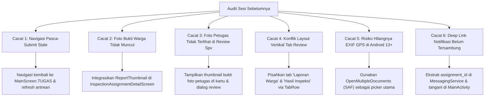

# Plan Komprehensif & Panduan Serah Terima: Alur Inspeksi Android Native

**Tanggal:** 15 November 2026  
**Ruang Lingkup:** Aplikasi Android Native (`android-native/`) & Kontrak Backend API (`backend_POSTGRESQL/`)  
**Tujuan Dokumen:** Menjadi dokumen rujukan dan panduan eksekusi komprehensif bagi sesi agen/developer berikutnya untuk menguji, memverifikasi, dan menyempurnakan alur inspeksi laporan kerusakan jalan tanpa konflik dengan fitur lain.

---

## 1. Konteks & Ringkasan Baseline

Fitur inspeksi memisahkan laporan awal warga dari pemeriksaan lapangan oleh petugas dan pengesahan operasional oleh supervisor:
1. **Laporan Warga / Temuan:** Masuk dengan status `Menunggu Review`.
2. **Antrean Inspeksi:** Supervisor memilih laporan dari kandidat antrean via `InspectionQueueSheet` untuk dimasukkan ke sesi patroli aktif sebuah tim.
3. **Pemeriksaan Petugas:** Petugas melihat daftar tugas di tab `TUGAS` (`InspectionTaskListScreen`), membuka detail tugas ([`InspectionAssignmentDetailScreen`](file:///home/marcille/Tugas/DeltaJalan/android-native/app/src/main/java/com/jalankita/app/feature/home/InspectionScreens.kt)), melihat foto bukti laporan warga, memulai tugas (`started`), dan mengisi form bukti hasil inspeksi dengan foto ber-GPS Sidoarjo ([`InspectionResultScreen`](file:///home/marcille/Tugas/DeltaJalan/android-native/app/src/main/java/com/jalankita/app/feature/home/InspectionResultScreen.kt)).
4. **Review Supervisor:** Hasil inspeksi (`submitted`) masuk ke antrean supervisor di tab Review ([`NativeInspectionReviewScreen`](file:///home/marcille/Tugas/DeltaJalan/android-native/app/src/main/java/com/jalankita/app/feature/supervisor/InspectionReviewScreen.kt)). Supervisor melihat foto bukti lapangan petugas dan memutuskan: `accept`, `return`, `reinspect`, atau `reject`.

---

## 2. Masalah yang Ditemukan & Solusi yang Telah Diterapkan

Dalam sesi ini, telah dilakukan audit menyeluruh pada kode sumber Android Native dan perbaikan berikut telah diintegrasikan serta berhasil dikompilasi:



### Rincian Perbaikan yang Telah Masuk ke Kode Sumber:
1. **Navigasi Petugas ([`MainActivity.kt`](file:///home/marcille/Tugas/DeltaJalan/android-native/app/src/main/java/com/jalankita/app/MainActivity.kt)):**
   - Callback `onSubmitted` pada `MainScreen.INSPECTION_RESULT` dan `INSPECTION_DISCOVERED` kini membersihkan ID aktif dan menavigasi langsung kembali ke `MainScreen.TUGAS` dengan memanggil `inspectionVm.load(force = true)`. Ini mencegah petugas terjebak di layar detail stale yang menampilkan status `started` dan memicu HTTP 422 saat submit ulang.
2. **Visualisasi Bukti Warga ([`InspectionScreens.kt`](file:///home/marcille/Tugas/DeltaJalan/android-native/app/src/main/java/com/jalankita/app/feature/home/InspectionScreens.kt)):**
   - `InspectionAssignmentDetailScreen` kini menampilkan kartu bukti awal warga lengkap dengan pratinjau gambar melalui `ReportThumbnail`, kode laporan, kecamatan, estimasi tingkat keparahan AI, dan deskripsi warga.
3. **Pratinjau Bukti Petugas untuk Supervisor ([`InspectionReviewScreen.kt`](file:///home/marcille/Tugas/DeltaJalan/android-native/app/src/main/java/com/jalankita/app/feature/supervisor/InspectionReviewScreen.kt)):**
   - `NativeInspectionReviewScreen` kini merender galeri pratinjau foto bukti hasil inspeksi petugas baik pada daftar kartu antrean maupun di dalam dialog keputusan review (`AlertDialog`), memungkinkan supervisor memeriksa foto sebelum memutuskan.
4. **Resolusi Layout Tab Review Supervisor ([`SupervisorScaffold.kt`](file:///home/marcille/Tugas/DeltaJalan/android-native/app/src/main/java/com/jalankita/app/feature/supervisor/SupervisorScaffold.kt)):**
   - Tab Review tidak lagi membagi layar secara vertikal 50/50. Telah dipasang `TabRow` di bagian atas dengan dua sub-tab: *"Laporan Warga"* dan *"Hasil Inspeksi"*. Setiap sub-tab mendapatkan ruang layar penuh (`fillMaxSize()`) sehingga scroll, sticky bar, dan dialog tidak saling bertabrakan.
5. **Penanganan EXIF GPS Picker ([`InspectionResultScreen.kt`](file:///home/marcille/Tugas/DeltaJalan/android-native/app/src/main/java/com/jalankita/app/feature/home/InspectionResultScreen.kt)):**
   - Menggunakan `ActivityResultContracts.OpenMultipleDocuments` (SAF) sebagai jalur utama untuk menjaga integritas tag EXIF tanggal dan GPS di Android 13+, dengan fallback aman ke Photo Picker (`PickMultipleVisualMedia`).
6. **Integrasi Deep Link Notifikasi ([`DeltaJalanMessagingService.kt`](file:///home/marcille/Tugas/DeltaJalan/android-native/app/src/main/java/com/jalankita/app/core/notify/DeltaJalanMessagingService.kt) & [`MainActivity.kt`](file:///home/marcille/Tugas/DeltaJalan/android-native/app/src/main/java/com/jalankita/app/MainActivity.kt)):**
   - Service notifikasi mengekstrak `assignment_id` dari payload data FCM, dan `MainActivity` menangani `deepLinkAssignmentId` untuk membuka tugas inspeksi terkait secara langsung.
7. **Klarifikasi Kolom `outcome` vs `review_status`:**
   - Kolom `result` pada tabel `inspection_results` difungsikan sebagai status review (`submitted`, `accepted`, `returned`, `reinspection_requested`, `rejected`).
   - Kolom `condition` dan `notes` difungsikan untuk temuan kondisi teknis kerusakan di lapangan.
   - Seluruh model DTO di [`InspectionModels.kt`](file:///home/marcille/Tugas/DeltaJalan/android-native/app/src/main/java/com/jalankita/app/core/network/InspectionModels.kt) dan migrasi database revisi (`2026_11_15_000001_allow_inspection_result_revisions.php`) sudah sinkron.

---

## 3. Checklist Eksekusi untuk Sesi Berikutnya

Sesi berikutnya dapat langsung memfokuskan pekerjaan pada validasi end-to-end melalui pengujian berikut:

### Skenario 1: Penugasan Antrean oleh Supervisor
- [ ] Buka akun supervisor &rarr; Navigasi ke tab **Jadwal Patroli** &rarr; Buka Sesi Patroli Aktif.
- [ ] Klik tombol **"Antrekan laporan untuk inspeksi"**.
- [ ] Pastikan daftar kandidat memuat laporan berstatus *"Menunggu Review"* yang belum memiliki assignment aktif.
- [ ] Pilih 1–3 laporan &rarr; Klik **"Antrekan"**.
- [ ] Verifikasi di backend / response bahwa session dan baris `survey_task_reports` berstatus `assigned` berhasil dibuat.

### Skenario 2: Pelaksanaan Tugas oleh Petugas
- [ ] Login sebagai petugas pada tim yang sama dengan sesi di atas.
- [ ] Buka tab **TUGAS** &rarr; Periksa kartu antrean pada bagian *"Inspeksi Laporan"*.
- [ ] Buka salah satu tugas:
  - [ ] Pastikan foto bukti awal laporan warga tampil jelas.
  - [ ] Pastikan tingkat keparahan awal, kecamatan, dan deskripsi warga tampil.
- [ ] Klik **"Mulai Inspeksi Lapangan"**:
  - [ ] Status berubah menjadi `started` dan tombol beralih ke form inspeksi.
- [ ] Pada form hasil inspeksi:
  - [ ] Pilih foto bukti kerusakan jalan dari perangkat (pastikan EXIF GPS dan tanggal valid di Sidoarjo).
  - [ ] Isi catatan teknis.
  - [ ] Klik **"Kirim Hasil Inspeksi"**.
  - [ ] Verifikasi bahwa setelah berhasil kirim, aplikasi otomatis kembali ke tab **TUGAS** dan kartu tugas tersebut sudah hilang dari antrean aktif.

### Skenario 3: Peninjauan Hasil oleh Supervisor & Reinspeksi
- [ ] Kembali ke akun supervisor &rarr; Buka tab **Review** &rarr; Pilih sub-tab **"Hasil Inspeksi"**.
- [ ] Pastikan tugas yang dikirim petugas muncul di daftar antrean beserta pratinjau thumbnail fotonya.
- [ ] Klik kartu untuk membuka dialog keputusan:
  - [ ] Foto bukti petugas dapat dilihat di dalam dialog.
  - [ ] Uji aksi **"Kembalikan ke Petugas"**: masukkan alasan &rarr; submit &rarr; verifikasi bahwa tugas kembali muncul pada petugas dengan status `started` dan catatan pengembalian terbaca.
  - [ ] Uji aksi **"Minta Inspeksi Ulang"**: masukkan alasan &rarr; submit &rarr; verifikasi bahwa sesi baru berjenis `reinspection` terbentuk dan histori lama tidak tertimpa.
  - [ ] Uji aksi **"Terima Hasil Inspeksi"**: submit &rarr; verifikasi status laporan berubah menjadi `Disetujui`.

### Skenario 4: Pengujian Kondisi Offline & Idempotensi
- [ ] Aktifkan mode pesawat saat mengirim form inspeksi &rarr; pastikan data masuk ke `OfflineInspectionQueue`.
- [ ] Matikan mode pesawat &rarr; periksa bahwa `InspectionUploadWorker` mengirim data saat koneksi kembali tanpa menduplikasi baris hasil inspeksi di server.

---

## 4. Perintah Verifikasi Build & Aturan Wajib (`AGENTS.md`)

```bash
# 1. Build APK Native (diizinkan oleh otorisasi AGENTS.md)
cd android-native && ./gradlew assembleDebug
# Lokasi APK: android-native/app/build/outputs/apk/debug/app-debug.apk

# 2. Pemindaian Keamanan Kunci / Token (wajib sebelum staging/laporan)
grep -rnE '[0-9]{8,10}:[A-Za-z0-9_-]{35}' --include='*.md' --include='*.php' --include='*.ts' --include='*.tsx' --include='*.sh' --include='*.yml' . | grep -v -e node_modules -e vendor -e '.git/' -e dist/ -e android/
grep -rnE '(LOCATIONIQ_KEY|_SECRET=|_TOKEN=|_KEY=|_PASSWORD=|PRIVATE_KEY)' --include='*.md' --include='*.php' --include='*.ts' --include='*.tsx' --include='*.json' --include='*.sh' --include='*.yml' . | grep -v -e node_modules -e vendor -e '.git/' -e dist/ -e android/ -e '.env.example'
grep -rn '-----BEGIN' --include='*.md' --include='*.php' --include='*.ts' --include='*.json' --include='*.sh' --include='*.yml' . | grep -v -e node_modules -e vendor -e '.git/'
```

### Aturan Kritis untuk Agen Berikutnya:
- **Device / Emulator Testing:** Interaksi dengan perangkat fisik atau emulator (`adb shell`, `am start`, `input tap`, `screencap`, dsb.) **wajib meminta izin eksplisit per-sesi** kepada pengguna dengan menyebutkan serial perangkat dan aksi spesifik.
- **Dilarang Menjalankan Dev Server:** Jangan jalankan `php artisan serve`, `npm run dev`, atau `vite`.
- **Dilarang Menjalankan Migrasi Berbahaya:** Jangan pernah menjalankan `migrate:fresh`, `migrate:reset`, `db:wipe`, atau perintah `DROP`.
- **Komunikasi:** Selalu gunakan Bahasa Indonesia dalam komunikasi dengan pengguna.
