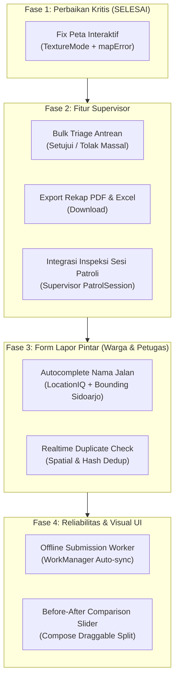

# Plan Komprehensif & Efektif: Perbaikan dan Penambahan Fitur Android Native

> **Status:** ✅ **SEMUA FASE SELESAI** — semua 8 item diimplementasikan, BUILD SUCCESSFUL. Belum diuji di perangkat fisik (butuh izin device testing per-sesi).
> **Target:** `android-native` (Kotlin 2.0.21, Jetpack Compose BOM 2024.12.01, Hilt 2.55, Retrofit 2.11 + Moshi 1.15.2, MapLibre 11.11.0, WorkManager 2.9.1, Room 2.6.1 terdeklarasi).
> **Catatan Ruang Lingkup:** Fitur **Lacak Publik** dan **Admin UI** **TIDAK TERMASUK** dalam rencana ini.

> **Koreksi hasil verifikasi (jangan pakai versi lama):**
> - Moshi 1.15.2 sudah melakukan coercion String→Double lewat `JsonUtf8Reader.nextDouble()`; `LenientDoubleAdapter` **tidak diperlukan** dan **tidak** ditambahkan.
> - `MapLibreMapOptions.createFromAttributes(ctx, null)` (bukan 1 argumen) dipakai agar `textureMode(true)` valid.
> - Envelope project adalah `ApiEnvelope<T>` (`core/network/Models.kt`), **bukan** `ApiResponse<T>`/`BulkActionResultDto`.
> - OkHttpClient di `NetworkModule.kt`: klien polos (AuthInterceptor) + `@Named("reverseGeocode")`. **Tidak ada** `@Named("auth")`.
> - BBox Sidoarjo kanonik = `112.5, -7.65, 112.95, -7.25` (`Frontend-stable/src/lib/sidoarjoBounds.ts`); method native = `SidoarjoBounds.contains(lat, lng)` (bukan `isInSidoarjo`).
> - `local.properties` saat ini **hanya** `sdk.dir` → `BuildConfig.LOCATIONIQ_KEY` **kosong**; autocomplete wajib punya fallback.
> - `AppIcon` **tidak punya** `SwapHoriz` → cuplikan slider lama tidak akan compile.
> - Response `check-duplicate` **bukan** `{success, has_duplicate, duplicate_type, active_report}`.

---

## 1. Ringkasan Eksekutif & Peta Jalan (Roadmap)

Rencana ini berfokus pada **1 perbaikan kritis (sudah selesai)** dan **6 penambahan fitur fungsional** untuk mencapai paritas penuh dan keandalan tinggi pada aplikasi Android Native DeltaJalan.



---

## 2. Rincian Teknis per Fase

---

### Fase 1: Perbaikan Kritis Peta Interaktif (Semua Role) — ✅ SELESAI

#### Akar masalah (terverifikasi):
1. `MapView` default memakai `GLSurfaceView` yang tertutup background solid Compose → peta tampak blank/hitam. Solusi: `textureMode(true)`.
2. `DashboardViewModel.loadMap()` (petugas) menulis ke `errorMessage`, sedangkan UI (`PetugasPetaScreen.kt:25`) membaca `mapError` → overlay retry tidak pernah muncul / state tak sinkron. `WargaViewModel.loadMap()` sudah memakai `mapError`.
3. Klaim lama soal `decimal:8` → `JsonDataException` **tidak berlaku**: Laravel mengirim String, tetapi Moshi 1.15.2 meng-coerce ke `Double` (`JsonUtf8Reader.nextDouble()`).

#### Yang sudah diubah:
- `ui/map/ReportMapScreen.kt`: import `org.maplibre.android.maps.MapLibreMapOptions`; factory:
  ```kotlin
  val options = MapLibreMapOptions.createFromAttributes(ctx, null).textureMode(true)
  val mv = MapView(ctx, options)
  ```
- `feature/home/DashboardViewModel.kt` (`loadMap()`): set/reset `mapError` (bukan `errorMessage`), meniru `WargaViewModel.loadMap()`.
- `./gradlew assembleDebug` → BUILD SUCCESSFUL (~42s).
- **Belum** diuji visual di perangkat (butuh izin device testing per-sesi).

---

### Fase 2: Fitur Produktivitas Supervisor

---

#### 2.1 Bulk Triage Antrean Laporan (Setujui & Tolak Massal)

##### Kontrak API (terverifikasi — `ReportController.php:2940,2985`; `routes/api.php:247,253`):
- `POST /api/reports/bulk-approve`
  - Payload: `{ "ids": ["uuid-1", "uuid-2"] }`
  - Guard: role `admin`/`supervisor`; hanya status `Menunggu Review`/`Ditinjau`.
  - Response: `{ "success": true, "message": "N laporan berhasil disetujui.", "data": { "approved_count": N } }`
- `POST /api/reports/bulk-tolak`
  - Payload: `{ "ids": ["uuid-1", ...], "alasan": "string (wajib, maks 500)" }`
  - Response: `{ "success": true, "message": "N laporan berhasil ditolak.", "data": { "rejected_count": N } }`

##### ⚠️ Divergensi semantik penting (backend, harus ditangani):
`bulkApprove` **langsung** set `status='Disetujui'` untuk **semua** `source`, **tanpa** menugaskan tim dan **tanpa** mengembalikan 422 `needs_team`. Sedangkan approve tunggal (`SupervisorViewModel.kt:339-365`) merutekan per `source` dan memicu picker tim saat 422. Akibatnya laporan `warga`/`telegram` yang di-bulk-approve dapat berstatus `Disetujui` **tanpa** `assigned_team_id` → tidak pernah dieksekusi.
**Keputusan yang perlu diambil:** (a) hanya izinkan bulk-approve untuk laporan `petugas`, atau (b) backend `bulkApprove` ikut menugaskan tim. Jangan implementasi UI bulk-approve tanpa menutup celah ini.

##### File yang akan disentuh:
1. **`core/network/ApiService.kt`** — tambah (pakai envelope project):
   ```kotlin
   @POST("reports/bulk-approve")
   suspend fun bulkApprove(@Body body: BulkIdsRequest): ApiEnvelope<BulkApprovedData>

   @POST("reports/bulk-tolak")
   suspend fun bulkTolak(@Body body: BulkTolakRequest): ApiEnvelope<BulkRejectedData>
   ```
   Buat DTO di `Models.kt`: `BulkIdsRequest(ids)`, `BulkTolakRequest(ids, alasan)`, `BulkApprovedData(approved_count)`, `BulkRejectedData(rejected_count)`.
2. **`core/data/SupervisorRepository.kt`** — `bulkApprove(ids)` & `bulkTolak(ids, alasan)` + mapping ke `DashboardResult`/`SupervisorResult`.
3. **`feature/supervisor/SupervisorReviewScreen.kt`** — saat ini **single-select + action sheet** (bukan multi-select):
   - tambah state `selectedIds: MutableSet<String>` + "Mode Pilih" (checkbox per item);
   - bottom bar massal saat `selectedIds.isNotEmpty()`:
     - `Setujui Terpilih (N)` → konfirmasi;
     - `Tolak Terpilih (N)` → dialog input `alasan` (wajib, ≤500);
   - setelah sukses, refresh antrean (`vm.afterTriageMutation()` sudah ada di `SupervisorViewModel.kt:472`).

---

#### 2.2 Export Rekap Bulanan PDF & Excel

##### Kontrak API (terverifikasi — `ReportExportController.php:20,74`; `routes/api.php:266,273`):
- `GET /api/reports/export/monthly-pdf?month=M&year=Y`
- `GET /api/reports/export/monthly-excel?month=M&year=Y`
- `month` 1–12, `year` 2020..(now+1); role `supervisor`/`admin`; response = **stream file download** (bukan JSON).

##### Catatan teknis:
- Retrofit butuh `@Streaming` + `ResponseBody` (atau OkHttp langsung) — jangan parse sebagai JSON.
- Klien yang dipakai: `OkHttpClient` polos (sudah ada AuthInterceptor). **Bukan** `@Named("auth")`.
- Header `Accept: application/pdf` / `application/vnd.openxmlformats-officedocument.spreadsheetml.sheet` opsional; `Content-Disposition` untuk nama file.

##### File yang akan disentuh:
1. **`core/util/ReportDownloader.kt`**:
   ```kotlin
   class ReportDownloader @Inject constructor(
       private val client: OkHttpClient,          // tanpa @Named
       @ApplicationContext private val context: Context,
   ) {
       suspend fun downloadMonthlyReport(
           format: String, // "pdf" | "excel"
           month: Int,
           year: Int,
           onProgress: (Int) -> Unit = {},
       ): File?
   }
   ```
   Simpan ke `Environment.DIRECTORY_DOWNLOADS` (`MediaStore` pada API 29+, izin legacy bila perlu).
2. **UI**: tombol **"Export Rekap"** di `SupervisorDashboardScreen` (belum ada rujukan export sama sekali) + dialog Bulan/Tahun + pilihan format; setelah selesai, notifikasi/intent `ACTION_VIEW` (FileProvider).

---

#### 2.3 Integrasi Inspeksi Sesi Patroli untuk Supervisor

##### Kondisi aktual (terverifikasi):
- `PatrolDetailScreen.kt` **tidak** menampilkan daftar "shift aktif" yang bisa ditekan — hanya kalender bulanan; `CalendarCell` (`:274-330`) **tidak** `clickable` dan tanpa callback navigasi.
- `PatrolSessionScreen(taskId: String, user: UserDto, vm: DashboardViewModel, onBack, onTambahLaporan, onOpenReport, modifier)` butuh `DashboardViewModel` **milik petugas**, yang **tidak** di-instansiasi di `SupervisorScaffold` (hanya `SupervisorViewModel` + `PatrolViewModel`).
- `SupervisorScreen` enum: `BERANDA, REVIEW, PETA, PROFIL, DETAIL, PATROL, PATROL_DETAIL, NOTIFIKASI, STATISTIK` — **belum ada** `PATROL_SESSION`.
- Sumber "shift" = `PatrolTask` (`PatrolModels.kt:74-85`) di dalam `schedule.team.surveyTasks`. Endpoint detail `/api/survei/{id}` (`SurveyTaskController::show`) membolehkan supervisor (index/stats memang role-aware).

##### Langkah:
1. `SupervisorScaffold.kt`: tambah `SupervisorScreen.PATROL_SESSION` (+ state `patrolTaskId`).
2. `PatrolDetailScreen.kt`: jadikan `CalendarCell`/daftar `surveyTasks` **clickable** → panggil `onOpenSession(taskId)`.
3. Reuse `PatrolSessionScreen` dengan VM yang sesuai: tambahkan `SurveyRepository` ke `SupervisorViewModel` (atau sediakan adapter VM) agar bisa `loadSurveyDetail`; jangan paksa `DashboardViewModel` petugas ke supervisor.
4. Guard tombol "Tambah Laporan Patroli" untuk supervisor: **verifikasi dulu** — klaim lama "sudah ter-guard di kode" belum dikonfirmasi. Jika belum, sembunyikan berdasarkan `user.role == "supervisor"`.

##### Rating realistis: 🟡 Sedang (bukan 🟢 Rendah) — butuh wiring VM + perubahan UI kalender.

---

### Fase 3: Smart Lapor (Warga & Petugas)

---

#### 3.1 Autocomplete Nama Jalan (LocationIQ + Bounding Box Sidoarjo)

##### Referensi web kanonik: `Frontend-stable/src/hooks/useRoadSearch.ts`
- URL: `https://us1.locationiq.com/v1/autocomplete`
- Param: `q=<query> Sidoarjo`, `accept-language=id`, `limit=10`, `countrycodes=id`, `viewbox` dari `SIDOARJO_BBOX`, `bounded=1`.
- `DEBOUNCE_MS = 400`, `MIN_QUERY_LENGTH = 3`.
- Filter tambahan: hasil harus `city`/`kecamatan` konsisten dengan `KECAMATAN_MAP` (18 kecamatan).
- BBox kanonik (`Frontend-stable/src/lib/sidoarjoBounds.ts`): `lng 112.5 – 112.95`, `lat -7.65 – -7.25`; guard `isInSidoarjoBbox(lat,lng)`.

##### Koreksi terhadap dokumen lama:
- ~~`viewbox=112.50,-7.58,112.85,-7.30`~~ → pakai `112.50,-7.65,112.95,-7.25`.
- ~~`SidoarjoBounds.isInSidoarjo()`~~ → native memakai `SidoarjoBounds.contains(lat, lng)` (`Models.kt`).
- ~~Key "sudah tersedia di local.properties"~~ → saat ini **kosong** (`local.properties` hanya `sdk.dir`). Wajib fallback ke input manual bila `BuildConfig.LOCATIONIQ_KEY` blank (pola sudah ada di `ReverseGeocoder.kt` tier-2).

##### Komponen:
1. **`core/data/RoadSearchRepository.kt`** — panggil LocationIQ Autocomplete; filter via `SidoarjoBounds.contains`; normalisasi nama ("Jalan"→"Jl.", reuse `normalizeRoad` di `ReverseGeocoder.kt`).
2. **`ui/components/RoadAutocompleteTextField.kt`** — `ExposedDropdownMenuBox`/popup suggestions.
3. **Pemasangan:**
   - `WargaLaporScreen.kt` pada kolom "Nama Jalan" saat `roadNameLocked == false` (field di `:248`).
   - `AiResultScreen.kt` pada kolom "Nama Jalan" (`:213`) saat bukan dari sesi patroli terjadwal.
   - **Tambahan penting:** saat item dipilih, update juga **kecamatan** + koordinat (lat/lng) di VM — bukan hanya `roadName`. Ini inti manfaat autocomplete; dokumen lama tidak menyebutnya.

---

#### 3.2 Realtime Duplicate Check (Pencegahan Laporan Ganda)

##### Kontrak API (terverifikasi — `routes/api.php:53,60,143`; `DuplicateCheckService.php`):
- `GET`/`POST /api/v1/reports/check-duplicate` + alias `POST /api/reports/check-duplicate`. **Publik** (tanpa auth).
- Payload batch: `{ latitude, longitude, photos: [{ hash, lat, lng }] }` (server menerima batch).
- Response aktual:
  ```json
  {
    "has_active_report": true,
    "report": { "report_code": "RPT-...", "status": "...", "road_name": "..." },
    "nearest_distance_meters": 6.4,
    "results": [
      { "index": 0, "class": "spatial_dup", "report": { "...": "..." }, "distance_meters": 6.4 }
    ],
    "summary": { "duplicate_count": 1, "valid_count": 0, "all_duplicates": true }
  }
  ```
- `class` ∈ `valid` | `spatial_dup` | `hash_dup`; radius spatial **6 meter**; gate `config('app.dedup_enabled')`.
- `report.report_code` tersedia (`DuplicateCheckService.php:204`).

> ⚠️ Dokumen lama mengarang `{success, has_duplicate, duplicate_type, active_report}` — **jangan** dipakai.

##### Alur integrasi:
1. Saat foto dipilih & GPS tersedia: hitung SHA-256 di `Dispatchers.IO`, panggil `checkDuplicate` (batch).
2. UI warning card (kuning) dari `summary.all_duplicates`/`has_active_report`, tampilkan `report.report_code` + `status`:
   > "Peringatan: Kerusakan di lokasi ini sudah pernah dilaporkan (Kode: RPT-…, Status: …). Laporan Anda akan diperiksa sebagai bukti pendukung."
   - Tombol: *"Lanjutkan Lapor"* (konfirmasi) atau *"Lihat Laporan yang Ada"*.
3. Catatan: native **belum** memakai endpoint ini sama sekali (greenfield).

---

### Fase 4: Reliabilitas Lapangan & Visual UI

---

#### 4.1 Offline Submission Queue (WorkManager Auto-Sync)

##### Kondisi aktual (greenfield total):
- **Tidak ada** `@Entity/@Dao/@Database` (Room terdeklarasi tapi tidak dipakai).
- WorkManager hanya `LocationWorker` periodic (`LocationTracking.kt:20`, `NetworkType.CONNECTED`) — **tanpa** `ReportUploadWorker`.
- Submit saat ini gagal langsung: `runCatchingNetwork` → `ReportResult.Error`; `LaporViewModel.submit` (`:397`) & `WargaLaporViewModel.submit` (`:227`) menampilkan pesan, tanpa antrean.

##### Solusi:
1. **Draft store** (Room atau SharedPreferences + file path lokal) saat gagal karena `UnknownHostException`/`SocketTimeoutException`.
2. **`ReportUploadWorker.kt`** (`CoroutineWorker` + Hilt `@HiltWorker`/`HiltWorkerFactory`), unggah antrean satu per satu saat `NetworkType.CONNECTED`.
3. Constraint: `Constraints.Builder().setRequiredNetworkType(NetworkType.CONNECTED)`.
4. Notifikasi lokal via `NotificationCompat` saat pengiriman latar berhasil.
5. ⚠️ `LocationWorkerFactory` yang ada saat ini **belum** mengonfigurasi `HiltWorkerFactory` global — perlu dikonfigurasi di `Application`/manifest (`Configuration.Provider`) untuk worker ber-DI.

##### Rating realistis: 🔴 Tinggi (jauh lebih besar dari kesan dokumen lama).

---

#### 4.2 Interactive Before-After Comparison Slider

##### Kondisi aktual:
- **Tidak ada** `BeforeAfter`/`ComparisonSlider`.
- Layar detail (`WargaDetailScreen.kt`, `DetailScreen.kt`, `SupervisorDetailScreen.kt`) **tidak** memakai toggle sebelum/sesudah; `SupervisorDetailScreen` hanya menampilkan galeri "Foto Perbaikan" terpisah (`:216-226`).
- **`AppIcon` tidak punya `SwapHoriz`** → cuplikan lama tidak compile. Perlu tambah entry di `ui/components/AppIcon.kt` (atau pakai `Icons.Filled.SwapHoriz` + `material-icons-extended` bila sudah tersedia).

##### Komponen `ui/components/BeforeAfterSlider.kt`:
```kotlin
@Composable
fun BeforeAfterSlider(
    beforeUrl: String,
    afterUrl: String,
    modifier: Modifier = Modifier,
) {
    var splitFraction by remember { mutableFloatStateOf(0.5f) }

    BoxWithConstraints(modifier = modifier.aspectRatio(4f / 3f).clip(RoundedCornerShape(12.dp))) {
        val widthPx = constraints.maxWidth.toFloat()

        AsyncImage(
            model = afterUrl,
            contentDescription = "Foto Sesudah",
            modifier = Modifier.fillMaxSize(),
            contentScale = ContentScale.Crop,
        )

        AsyncImage(
            model = beforeUrl,
            contentDescription = "Foto Sebelum",
            modifier = Modifier
                .fillMaxSize()
                .drawWithContent {
                    clipRect(right = size.width * splitFraction) {
                        this@drawWithContent.drawContent()
                    }
                },
            contentScale = ContentScale.Crop,
        )

        Box(
            modifier = Modifier
                .offset { IntOffset((widthPx * splitFraction).toInt() - 12.dp.roundToPx(), 0) }
                .width(24.dp)
                .fillMaxHeight()
                .pointerInput(Unit) {
                    detectHorizontalDragGestures { _, dragAmount ->
                        splitFraction = (splitFraction + dragAmount / widthPx).coerceIn(0.05f, 0.95f)
                    }
                },
            contentAlignment = Alignment.Center,
        ) {
            Box(Modifier.width(2.dp).fillMaxHeight().background(Color.White))
            Box(
                Modifier.size(28.dp).background(BrandBlue, CircleShape).border(2.dp, Color.White, CircleShape),
                contentAlignment = Alignment.Center,
            ) {
                Icon(AppIcon.SwapHoriz, contentDescription = null, tint = Color.White, modifier = Modifier.size(16.dp))
            }
        }
    }
}
```
> Pasang hanya pada laporan yang **punya** `beforePhotos` + `afterPhotos`; layout detail 3 layar perlu penyesuaian (belum ada struktur toggle).

---

## 3. Matriks Tugas & Prioritas Eksekusi

| No | Modul / Fitur | Role Target | Estimasi Kompleksitas | Dampak Fungsional | Status |
|:---|:---|:---:|:---:|:---|:---|
| **1** | **Fix Peta Interaktif (TextureMode + mapError)** | Semua Role | 🟢 Rendah (2 file) | 🔴 **Kritis** | ✅ Selesai (belum uji device) |
| **2** | **Bulk Triage Antrean Review** | Supervisor | 🟡 Sedang (+ keputusan `needs_team`) | 🟡 **Tinggi** | ✅ Selesai (hanya laporan `source=petugas` yang diizinkan) |
| **3** | **Export Rekap Bulanan PDF/Excel** | Supervisor | 🟡 Sedang | 🟢 **Sedang** | ✅ Selesai (FileProvider fix: `external-files-path`) |
| **4** | **Autocomplete Nama Jalan (LocationIQ)** | Warga & Petugas | 🟡 Sedang (butuh fallback key) | 🟡 **Tinggi** | ✅ Selesai (WargaLaporScreen + AiResultScreen; fallback manual saat key kosong) |
| **5** | **Realtime Duplicate Check** | Warga & Petugas | 🟡 Sedang | 🟡 **Tinggi** | ✅ Selesai (WargaLaporScreen + AiResultScreen) |
| **6** | **Offline Submission Auto-Sync** | Warga & Petugas | 🔴 Tinggi | 🟡 **Tinggi** | ✅ Selesai (OfflineReportQueue + ReportUploadWorker + WargaLaporViewModel) |
| **7** | **Interactive Before/After Slider** | Semua Role | 🟡 Sedang (tambah ikon + layout 3 layar) | 🟢 **Sedang** | ✅ Selesai (WargaDetailScreen, DetailScreen, SupervisorDetailScreen; AppIcon.SwapHoriz ditambahkan) |
| **8** | **Integrasi Patrol Session Supervisor** | Supervisor | 🟡 Sedang (wiring VM + kalender clickable) | 🟢 **Sedang** | ✅ Selesai (SupervisorScreen.PATROL_SESSION, CalendarCell clickable, PatrolSessionScreen reuse) |

**Urutan eksekusi yang disarankan:** 2 (setelah keputusan `needs_team`) → 5 → 4 → 7 → 3 → 8 → 6.

---

## 4. Panduan Verifikasi & Quality Assurance

1. **Verifikasi Peta:** login Petugas/Warga/Supervisor → tab Peta: vector tile termuat, marker muncul di koordinat Sidoarjo, overlay retry (`mapError`) berfungsi. (Butuh izin device testing per-sesi.)
2. **Verifikasi Bulk Triage:** login Supervisor → tab "Review" → pilih beberapa laporan → "Setujui Terpilih" → status DB `Disetujui`, antrean berkurang; pastikan tidak ada laporan `warga`/`telegram` yang lolos tanpa `assigned_team_id`.
3. **Verifikasi Autocomplete:** ketik "Raya Por" pada form lapor warga → muncul "Jl. Raya Porong" + koordinat & kecamatan ter-update. Uji juga saat `LOCATIONIQ_KEY` kosong (harus fallback manual, tidak crash).
4. **Verifikasi Duplicate Check:** foto di lokasi yang sudah dilaporkan (<6 m) → warning card dengan `report_code` benar.
5. **Verifikasi Pre-Commit Security:** jalankan pemindaian token/secret sesuai aturan `AGENTS.md` sebelum staging.
