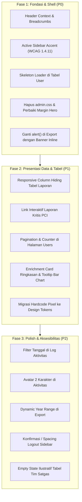

# Rencana Perbaikan UI/UX Admin Panel — DeltaJalan

> **Target Lingkup:** Frontend Web (`Frontend-stable/src/routes/admin/` & `src/components/jk/AdminLayout.tsx`)  
> **Acuan Desain:** `DESIGN.md` (Civic Precision Design System), WCAG 2.1 AA, Material Design 3  
> **Status:** Draft Rencana Eksekusi  

---

## 1. Latar Belakang & Tujuan

Berdasarkan audit UI/UX mendalam pada modul admin DeltaJalan, antarmuka saat ini telah memiliki fungsionalitas inti yang lengkap (dashboard metrik, kelola user, laporan, tim satgas, PCI, export, log aktivitas, dan konfigurasi). Namun, ditemukan sejumlah friksi visual, masalah aksesibilitas, dan inkonsistensi yang mengurangi efisiensi kerja operator dinas:

1. **Navigasi & Konteks Lemah:** Header atas kosong tanpa judul halaman/breadcrumb; indikator rute aktif di sidebar memiliki kontras rendah.
2. **Kerapuhan Visual & Standarisasi:** Penggunaan stylesheet sementara (`admin.css` dengan hardcode margin), hardcode ukuran font (pixel) alih-alih design tokens `DESIGN.md`.
3. **Data-Dense UI Bottlenecks:** Tabel laporan terlalu padat (9 kolom tanpa scroll affordance / responsive hiding); halaman PCI tidak terhubung langsung ke detail laporan; loading state di tabel user hanya teks statis.
4. **Interaksi & Form Feedback:** Penggunaan dialog browser bawaan (`window.alert()`), dropdown aksi tanpa animasi, dan ketiadaan filter esensial pada log aktivitas.

**Tujuan Utama:**
- Meningkatkan *clarity* dan *sense of place* bagi admin saat menavigasi modul.
- Menyelaraskan seluruh tipografi dan komponen dengan prinsip **Civic Precision** di `DESIGN.md`.
- Mempercepat alur kerja harian (inspeksi laporan kritis, monitoring PCI, dan ekspor data).

---

## 2. Matriks Prioritas Kerja (P0, P1, P2)

---

## 3. Rencana Eksekusi Bertahap

### Fase 1: Fondasi Shell, Aksesibilitas Kritis & Quick Wins (P0)

*Tujuan: Memperbaiki pengalaman navigasi menyeluruh di seluruh 8 sub-halaman admin.*

#### 1.1 Header Kontekstual & Breadcrumbs (`AdminLayout.tsx`)
- **Masalah:** Header sticky hanya berisi tombol hamburger mobile, spacer kosong, bell notifikasi, dan avatar. Admin tidak memiliki indikator visual judul halaman yang sedang aktif.
- **Tindakan:**
  - Tambahkan mapping rute ke judul halaman dan breadcrumb:
    - `/admin/dashboard` → "Dashboard"
    - `/admin/users` → "Manajemen User"
    - `/admin/teams` → "Tim Satgas"
    - `/admin/reports` → "Semua Laporan"
    - `/admin/pci` → "PCI Dashboard"
    - `/admin/export` → "Export Laporan"
    - `/admin/activity` → "Aktivitas Sistem"
    - `/admin/config` → "Pengaturan Sistem"
  - Render title dengan token `font-headline-sm text-headline-sm font-semibold text-on-surface`.
  - Tampilkan breadcrumb ringkas di atas title pada desktop (`Admin / [Nama Halaman]`).

#### 1.2 Indikator Navigasi Sidebar Berkualitas Tinggi (`AdminLayout.tsx`)
- **Masalah:** Active state hanya mengandalkan `bg-white/15` yang sulit dibedakan dari hover `bg-white/10`.
- **Tindakan:**
  - Tambahkan *left active accent bar* (`before:absolute before:left-0 before:w-1 before:h-5 before:bg-white before:rounded-r-full`).
  - Tingkatkan kontras background aktif menjadi `bg-white/20 text-white font-semibold shadow-xs`.

#### 1.3 Pembersihan CSS Hack & Perbaikan Layout Hero (`dashboard.tsx`, `admin.css`)
- **Masalah:** `admin.css` memuat `.margin-top { margin-top: 50px; }` untuk mengatasi overlap hero section.
- **Tindakan:**
  - Hapus file `admin.css` dan import-nya di `dashboard.tsx` serta `pci.tsx`.
  - Perbaiki tata letak hero banner menggunakan spacing native Tailwind (`mt-6` / `pt-2`).
  - Ganti badge "Admin" di hero banner menjadi `rounded-full` sesuai kaidah token badge di `DESIGN.md`.

#### 1.4 Skeleton Loader & Error State Tabel User (`users.tsx`)
- **Masalah:** Loading hanya berupa teks mentah `"Memuat data..."`, error state tanpa tombol retry.
- **Tindakan:**
  - Buat skeleton table row (5 baris) dengan efek `animate-pulse` dan bg `#F1F5F9`.
  - Implementasikan error state terpusat dengan icon error dan tombol "Coba Lagi" (`usersQuery.refetch()`).

#### 1.5 Eliminasi `window.alert()` pada Export (`export.tsx`)
- **Masalah:** Error penanganan download menggunakan alert pop-up peramban.
- **Tindakan:**
  - Tambahkan state `errorMsg` lokal.
  - Tampilkan banner peringatan error bernuansa `bg-red-50 border border-red-200 text-error` yang informatif dan dismissible.

---

### Fase 2: Presentasi Data, Visualisasi & Tabel Responsif (P1)

*Tujuan: Mengoptimalkan pemrosesan data bervolume tinggi bagi supervisor/admin.*

#### 2.1 Optimasi Tabel Laporan & Horizontal Scroll Affordance (`reports.tsx`)
- **Masalah:** 9 kolom membuat tabel terpotong di layar standar (1280px–1366px).
- **Tindakan:**
  - Terapkan responsive table column: kolom `district` disatukan di bawah nama jalan sebagai subteks; kolom `pci_score` disembunyikan di layar kecil atau diberi opsi toggle.
  - Tambahkan wrapper dengan gradient scroll indicator kanan untuk memberi tanda bahwa tabel dapat digeser.
  - Berikan animasi halus pada action popover/menu (`animate-in fade-in slide-in-from-top-1 duration-150`).

#### 2.2 Integrasi Alur Kerja Laporan Kritis PCI (`pci.tsx`)
- **Masalah:** Tabel "Laporan Kritis (PCI ≤ 40)" menampilkan kode laporan tanpa tautan ke halaman detail.
- **Tindakan:**
  - Ubah kode laporan menjadi komponen `<Link to="/detail-report" search={{ reportId: r.id }}>` dengan styling link brand (`text-[#1A4F8A] hover:underline font-mono`).
  - Tambahkan tombol pintasan "Tinjau Laporan" di ujung kolom aksi.

#### 2.3 Pagination & User Counter (`users.tsx`)
- **Masalah:** Query data dibatasi 100 tanpa navigasi halaman dan tanpa indikator jumlah pengguna.
- **Tindakan:**
  - Tambahkan label counter hasil filter: `"Menampilkan {filteredUsers.length} pengguna"`.
  - Siapkan pagination konsisten dengan tabel laporan (`page`, `limit: 20`, navigasi "Sebelumnya" & "Selanjutnya").

#### 2.4 Peningkatan Dashboard Analytics (`dashboard.tsx`)
- **Masalah:** Card "Ringkasan" samping chart terlalu lengang; bar chart tidak menampilkan nilai detail saat disentuh/hover.
- **Tindakan:**
  - Tambahkan metric "Tingkat Penyelesaian Laporan" (% selesai vs total) dengan visualisasi progress bar atau circular indicator.
  - Tambahkan tooltip interaktif atau data-label pada stacked bar chart mingguan/bulanan.
  - Sediakan empty state yang ramah dan terarah pada tabel "Kinerja Tim Satgas" jika data belum ada, lengkap dengan CTA "Buat Tim Baru".

#### 2.5 Standardisasi Tipografi ke Design Tokens (Semua Halaman Admin)
- **Tindakan:**
  - Ganti seluruh kelas arbitrer `text-[22px]` dengan `font-headline-sm text-headline-sm` atau `font-headline-md text-headline-md`.
  - Ganti `text-[13px]` dengan `font-body-sm text-body-sm`.
  - Ganti `text-[11px]` dengan `font-label-sm text-label-sm`.
  - Pastikan seluruh kode ID/laporan menggunakan font `font-id-code text-id-code` (JetBrains Mono).

---

### Fase 3: Form Ergonomics, Filter Lanjutan & Finishing (P2)

*Tujuan: Melengkapi fitur pendukung dan pencegahan kesalahan input.*

#### 3.1 Peningkatan Audit Trail Aktivitas (`activity.tsx`)
- **Masalah:** Hanya filter nama aktor; inisial avatar hanya 1 huruf; tidak ada filter rentang tanggal.
- **Tindakan:**
  - Tambahkan filter rentang tanggal sederhana (Tanggal Mulai – Selesai).
  - Ubah ekstraksi inisial avatar dari 1 karakter menjadi 2 karakter pertama dari nama pengguna (contoh: "Budi Santoso" → "BS").

#### 3.2 Fleksibilitas Pemilihan Tahun Export (`export.tsx`)
- **Masalah:** Array tahun statis `[2024, 2025, 2026, 2027]`.
- **Tindakan:**
  - Buat generator tahun dinamis berbasis `new Date().getFullYear() - 2` sampai `+ 2`.

#### 3.3 Penyesuaian Pengaturan & Keamanan Logout (`AdminLayout.tsx`, `config.tsx`)
- **Masalah:** Tombol "Keluar" di sidebar bawah rawan tertekan tanpa sengaja; versi sistem di config berupa teks statis.
- **Tindakan:**
  - Berikan margin pemisah atau konfirmasi ringkas sebelum logout dieksekusi.
  - Sinkronkan informasi versi aplikasi dengan endpoint `/api/app/version` bila tersedia, atau tambahkan catatan dinamis.

---

## 4. Rincian File yang Terdampak

| File Komponen / Rute | Prioritas | Perubahan Utama |
|---|---|---|
| `src/components/jk/AdminLayout.tsx` | **P0** | Dynamic page title header, active accent bar sidebar, breadcrumbs, pemisahan logout |
| `src/routes/admin/admin.css` | **P0** | **Dihapus total** (migrasi penuh ke utility Tailwind) |
| `src/routes/admin/dashboard.tsx` | **P0 / P1** | Pembersihan margin hack, tooltip stacked bar chart, enrichment ringkasan card, empty state satgas |
| `src/routes/admin/users.tsx` | **P0 / P1** | Skeleton table loader, tombol retry error, pagination, counter jumlah user |
| `src/routes/admin/export.tsx` | **P0 / P2** | Penggantian `alert()` ke inline error banner, generator rentang tahun dinamis |
| `src/routes/admin/reports.tsx` | **P1 / P2** | Penataan kolom responsif, scroll affordance, transisi animasi popup aksi |
| `src/routes/admin/pci.tsx` | **P1** | Link interaktif dari tabel laporan kritis ke `/detail-report` |
| `src/routes/admin/activity.tsx` | **P2** | Filter tanggal audit log, avatar inisial 2 karakter |
| `src/routes/admin/config.tsx` | **P2** | Standarisasi token tipografi, pengecekan data dinamis versi aplikasi |

---

## 5. Kriteria Keberhasilan & Verifikasi

1. **Aksesibilitas & Kontras:**
   - Navigasi sidebar lulus uji rasio kontras WCAG 2.1 AA (minimal 4.5:1 untuk teks, 3:1 untuk active state indicator).
2. **Kesesuaian Desain (Design Fidelity):**
   - Tidak ada lagi kelas `text-[22px]`, `text-[13px]`, atau `admin.css`.
   - Menggunakan pasangan font **Manrope** (headline) dan **Inter** (body) secara konsisten.
3. **Kinerja & Responsivitas:**
   - Layar dashboard dan laporan tidak mengalami layout shift (CLS) saat data selesai dimuat berkat skeleton loading.
   - Tabel dapat dibaca dengan jelas pada resolusi 1280px tanpa broken layout.
4. **Validasi Teknis:**
   - Menjalankan `npm run lint` dan `npm run build` di direktori `Frontend-stable/` tanpa error kompilasi.

---

## 6. CROSSCHECK 2026-11-27 (verifikasi ke kode, sebelum eksekusi)

### 6.1 Klaim yang terbukti benar

| Klaim | Bukti |
|---|---|
| `admin.css` hanya hack margin dan diimpor 2 halaman | File 36 byte, isi `.margin-top{margin-top:50px}`; diimpor `dashboard.tsx:10`, `pci.tsx:11`; dipakai `dashboard.tsx:250` |
| Header admin tanpa judul halaman | `AdminLayout.tsx:137-149`: hamburger + `
` + `NotificationBell` + avatar |
| Kontras active vs hover sidebar rendah | `AdminLayout.tsx:92-93` `bg-white/15` vs `bg-white/10`. Terukur: **1,45:1** vs **1,27:1** (butuh ≥3:1 untuk indikator UI, WCAG 1.4.11) |
| Tabel user tanpa pagination/retry | `users.tsx:53` `limit=100`; `:137` teks "Memuat data..."; tidak ada state error/refetch |
| `alert()` di export | `export.tsx:105` |
| Tahun export statis | `export.tsx:144` `[2024, 2025, 2026, 2027]` |
| Aktivitas: filter nama saja, inisial 1 huruf | `activity.tsx:106` placeholder "Cari nama pengguna..."; `:125` `[0]` |
| Laporan kritis PCI tanpa tautan | `pci.tsx:221` `{r.report_code}` teks biasa; `KritisReport.id` ada → `search={{ reportId: r.id }}` sah (`detail-report.tsx:45,68`) |
| Versi aplikasi hardcode | `config.tsx:158` `"2.0.0"` |
| Token tipografi tersedia | `styles.css:242-266` (`--text-headline-sm/md`, `--text-body-sm`, `--text-label-sm`, `--text-id-code`, `--font-*`) → kelas `text-*`/`font-*` dihasilkan Tailwind v4 |

### 6.2 Premis yang harus dikoreksi

| Klaim dokumen | Kenyataan |
|---|---|
| Tabel laporan 9 kolom | **10 kolom** (`reports.tsx:309-325`: checkbox, Kode, Ruas Jalan, Kecamatan, Severity, PCI, Status, Tim Satgas, Tanggal, Aksi) |
| Empty state "Kinerja Tim Satgas" belum ada | **Sudah ada** (`dashboard.tsx:541` "Belum ada data Tim Satgas") — kurangnya hanya CTA |
| Buat skeleton table row dari nol | `components/jk/Skeleton.tsx:62` **sudah ada `SkeletonTableRow({cols})`** → wajib dipakai ulang |
| Buat empty state ilustratif baru | `components/jk/EmptyState.tsx` sudah mendukung ikon + `action` (CTA) → wajib dipakai ulang |
| Judul halaman dinamis | `useRouterState` **0 kemunculan** di repo; yang dipakai `useLocation` (8×) dan `useNavigate` (54×) → pakai `useLocation().pathname`. Pola header sudah ada di `components/jk/TopBar.tsx` (`title`/`back`/`right`) |
| `text-[22px]` → `text-headline-sm` | `headline-sm` = 18px, sedangkan `--text-headline-md` = 24px lebih dekat; 13 tempat akan menyusut 4px bila dipaksa ke `headline-sm` |
| Cukup naikkan latar aktif ke `bg-white/20` | Terukur `bg-white/20` hanya **1,64:1** — masih < 3:1. Yang memenuhi justru **bar aksen putih solid** (putih vs `#1e40af` = **8,72:1**) |
| `/api/app/version` untuk versi aplikasi | Endpoint **khusus APK Android** (`ApkDownloadController::version`: `min/latest_version_code`, `apk_url`, `force_update`) → di config admin harus diberi label "Versi APK Android", bukan versi panel web |
| Daftar file §4 | **`teams.tsx` tidak terdaftar** padahal P2 menyentuh empty state Tim Satgas |
| Kriteria sukses: `npm run lint` tanpa error | Baseline: **3.059 error** di seluruh repo (2.937 auto-fixable), folder admin sendiri **50 error** (48 Prettier + 2 `no-empty`). Kriteria realistis: **tidak menambah error baru di berkas yang disentuh** |

### 6.3 Volume kerja nyata

184 kelas font piksel arbitrer di berkas admin: `13px`×60, `12px`×30, `11px`×24, `18px`×17, `22px`×13, `15px`×10, `14px`×9, `16px`×7, `20px`×6, `28px`×3, `10px`×3, `48px`×1.
Pemetaan yang diusulkan: `11/12px` → `text-label-sm` (12px); `13/14px` → `text-body-sm` (14px); `18px` → `text-headline-sm` (18px);
`20px` → `headline-md-mobile`, `22px` → `text-headline-md` (24px); `10px`/`15px`/`16px` dibulatkan ke `label-sm`/`body-sm`/`body-md`.

### 6.4 Catatan risiko

- Jangan jalankan `npm run format` massal (diff ratusan berkas); rapikan hanya berkas yang disentuh.
- `Frontend-stable` saat ini **bersih** dari perubahan belum commit → aman mulai dari sini.
- Lingkup kerja sebelumnya dibatasi ke `android-native/` + `backend_POSTGRESQL/`; dokumen ini menyentuh `Frontend-stable/` sehingga butuh persetujuan eksplisit.

---

## 7. HASIL EKSEKUSI FASE 1 (P0)

| Item | Berkas | Hasil |
|---|---|---|
| 1.1 Header kontekstual + breadcrumb | `AdminLayout.tsx` | `PAGE_TITLES` 8 rute; breadcrumb `Admin / …` (desktop) + `<h1>` 18sp; fallback "Admin" untuk rute tak dikenal |
| 1.2 Aksen navigasi aktif | `AdminLayout.tsx` | Bar aksen putih solid (`before:bg-white`, 8,72:1) + `bg-white/20` + `shadow-xs` + `aria-current="page"`. Tidak mengandalkan latar saja karena `bg-white/20` hanya 1,64:1 |
| 1.3 Hapus `admin.css` | `admin.css`, `dashboard.tsx`, `pci.tsx` | Berkas dihapus, import dibuang, kelas `margin-top` dihilangkan, badge hero jadi `rounded-full` |
| 1.4 Skeleton + error retry tabel user | `users.tsx` | Pakai ulang `SkeletonTableRow({cols=6})` (5 baris, header tetap) dan `EmptyState` + aksi "Coba Lagi" (`usersQuery.refetch()`) |
| 1.5 Banner galat export | `export.tsx` | `alert()` diganti banner `role="alert"` yang bisa ditutup; pesan dibersihkan saat unduhan dimulai ulang |

### Verifikasi

- `npx eslint` berkas yang disentuh: **0 error** (1 error Prettier lama di `AdminLayout.tsx` sekaligus diperbaiki).
- Baseline yang tidak disentuh tetap: `dashboard.tsx` 37 error, `pci.tsx` 7 error (semua Prettier lama) — **tidak bertambah**.
- `npm run build`: **exit 0**.
- `npx tsc --noEmit`: tidak ada error baru di berkas yang disentuh (3 error lama: prop `filled` pada `Icon` dan cast Capacitor di `export.tsx`).
- Kelas `shadow-xs` dan `before:` ditemukan di CSS hasil build (`--tw-content: ""`) → aksen pasti tampil.

### Temuan lama (di luar lingkup, belum diperbaiki)

`Icon` tidak mengenal prop `filled`, padahal dipakai 5 berkas (`AdminLayout`, `BottomNav`, `Sidebar`, `GpsBanner`, `PublicLayout`) → ikon aktif tidak pernah terisi penuh.

---

## 8. HASIL EKSEKUSI FASE 2 (P1) & FASE 3 (P2)

### Fase 2

| Item | Berkas | Hasil |
|---|---|---|
| 2.1 Tabel laporan responsif | `reports.tsx` | Kolom Kecamatan dilebur jadi subteks di bawah nama jalan (10 → 9 kolom), kolom PCI `hidden lg:table-cell`, gradien penanda geser di kanan (khusus mobile), menu aksi memakai `animate-fade-in` (token yang benar-benar ada) |
| 2.2 Tautan laporan kritis | `pci.tsx` | Kode laporan jadi `Link` ke `/detail-report?reportId=…` + tombol "Tinjau Laporan" di kolom Aksi baru; `colSpan` disesuaikan |
| 2.3 Paginasi + penghitung user | `users.tsx` | `limit=20` + `page`, queryKey ikut halaman, filter mereset halaman, teks "Menampilkan a–b dari N pengguna", tombol Sebelumnya/Selanjutnya + indikator `page / lastPage`. Backend sudah mendukung (`UserController::index` → `total`, `page`, `last_page`) |
| 2.4 Dashboard analytics | `dashboard.tsx` | Kartu Ringkasan + "Tingkat Penyelesaian" (progress bar ber-`role="progressbar"`), tooltip untuk ketiga segmen chart, "Kinerja Tim Satgas" kosong memakai `EmptyState` + CTA "Buat Tim Baru" |
| 2.5 Migrasi tipografi | 9 berkas | **155 penggantian**: 0 kelas `text-[Npx]` tersisa (kecuali `!text-[Npx]` pada `Icon` yang dipakai untuk menghitung ukuran ikon), `font-mono` → `font-id-code` untuk semua kode laporan |

### Fase 3

| Item | Berkas | Hasil |
|---|---|---|
| 3.1 Audit trail | `activity.tsx` | Filter rentang tanggal (`from`/`to`, sudah didukung `StatusLogController::index`), tombol "Reset filter", inisial avatar 2 huruf (`Budi Santoso` → `BS`) |
| 3.2 Tahun export dinamis | `export.tsx` | `TAHUN_OPSI` = tahun ini −2 … +2 |
| 3.3 Logout & versi | `AdminLayout.tsx`, `config.tsx` | Tombol Keluar diberi garis pemisah + `ConfirmDialog`; versi hardcode `2.0.0` diganti dua baris dinamis dari `/api/app/version` yang **dilabeli jelas "Versi APK Android"** (endpoint itu bukan versi panel web) |

### Verifikasi

- `npx eslint src/routes/admin src/components/jk/AdminLayout.tsx`: **0 error** (baseline 50).
- `npm run build`: **exit 0** (2 percobaan pertama gagal karena bentrok nama variabel `from`/`to` dengan variabel paginasi yang sudah ada — sudah diganti `dariTanggal`/`sampaiTanggal`).
- `npx tsc --noEmit`: hanya error lama tersisa (prop `filled` pada `Icon`, cast Capacitor di `export.tsx`, tipe query self-reference pada `activity.tsx`/`reports.tsx`).
- 17 kelas token tipografi yang dipakai semuanya ada di CSS hasil build.

### Temuan lama yang belum diperbaiki (di luar lingkup)

1. `reports.tsx` bulk approve/tolak memakai `fetch` tanpa memeriksa `res.ok` dan menelan galat → admin bisa melihat "berhasil" padahal gagal. Butuh mekanisme umpan balik (toast/banner) sebelum diperbaiki.
2. `detail-report.tsx:1428` memakai `animate-in fade-in zoom-in` — kelas plugin `tailwindcss-animate` yang tidak terpasang, jadi animasinya tidak pernah berjalan.
3. `Icon` belum mengenal prop `filled` yang dipakai 5 berkas.
